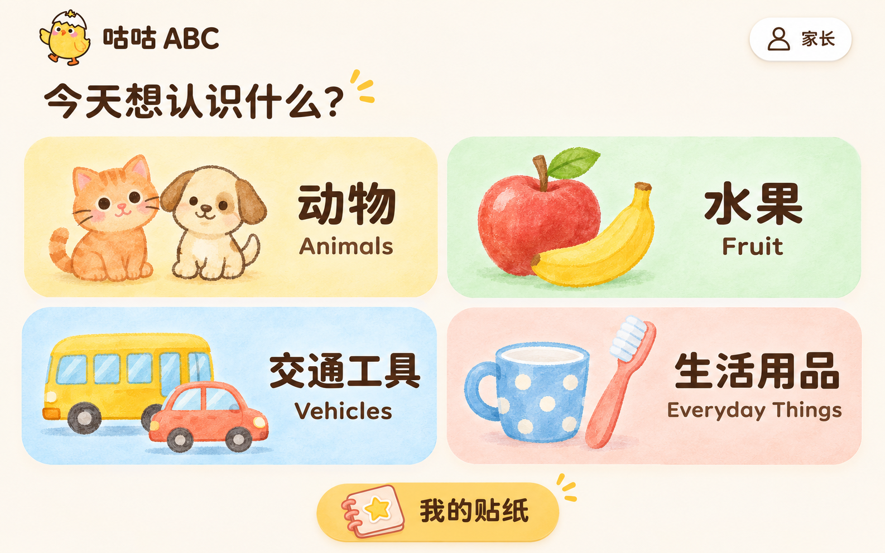
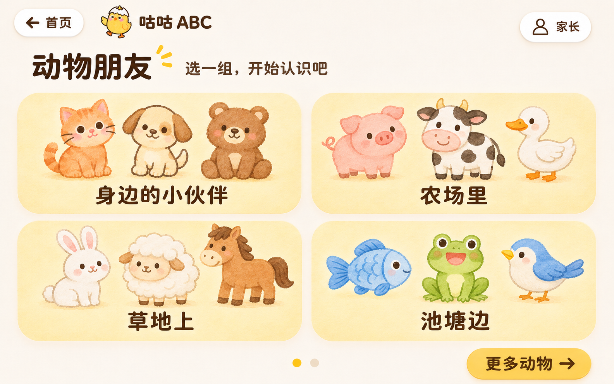

# V2 首页与动物选课 UI 定稿

- 定稿日期：2026-11-11。
- 确认依据：用户选择首页方案 1，并确认配套动物选课页符合预期。
- 状态：已按定稿实现原生 Compose 分类首页和图片选课页；新增三类内容均有图片及离线发音。功能范围见 [v2 功能清单](../v2版本功能清单说明文档.md)。
- 适用场景：3 岁以上儿童自主选择图片小课，认识事物并听英文发音。

## 首页分类

首页使用 2 × 2 大图入口，分别为动物、水果、交通工具和生活用品。插画是主要识别线索，中英文名称辅助说明。点击分类进入对应的图片选课页，不再要求长按家长入口才能选择课程。

保留顶部品牌与家长入口，以及底部“我的贴纸”入口。延续横屏布局、奶油色背景、棕色文字、柔和插画和圆角触控区域。

## 动物选课

现有 8 节动物课分为两页，每页 4 组，以 2 × 2 图片卡片展示。每张卡片显示该课的 3 个动物和分组标题；整张卡片可点击，直接进入该组单词学习，不增加确认弹窗。

| 页码 | 分组 | 对应词汇 |
| --- | --- | --- |
| 第 1 页 | 身边的小伙伴 | Cat、Dog、Bear |
| 第 1 页 | 农场里 | Pig、Cow、Duck |
| 第 1 页 | 草地上 | Rabbit、Sheep、Horse |
| 第 1 页 | 池塘边 | Fish、Frog、Bird |
| 第 2 页 | 树林里 | Fox、Monkey、Deer |
| 第 2 页 | 动物园 | Lion、Tiger、Panda |
| 第 2 页 | 大个子朋友 | Elephant、Giraffe、Zebra |
| 第 2 页 | 特别的朋友 | Owl、Turtle、Butterfly |

第 1 页右下“更多动物”切换至其余课程；左上“首页”返回分类首页。第二页应提供返回第一页的翻页操作，具体视觉细节尚未单独出图审定。

## 已确认的交互边界

- 内容选择交给儿童：分类与小课均可直接点击。
- 按最新交互要求，点击家长入口即打开设置弹框，承载时长、声音等设置；选课不依赖家长菜单。
- 选择小课后衔接现有“认一认 → 听一听 → 答对啦 → 完成页”流程。
- 保留每日 5 分钟额度校验；切换分类或课程不重置额度，家长主动重置仍在设置弹框内进行。
- 学习记录与贴纸规则沿用现有实现，不新增积分、排名或解锁门槛。

## 开发补充（2026-11-11）

- 水果、交通工具、生活用品各实现 6 个词、2 组小课，复用已确认的图片卡片布局；两组一页，放大并垂直居中展示双卡，不放占位课程。
- 动物第二页使用相同布局，右下“前一页”返回；从单词卡返回会保留原选课页。
- 贴纸册增加四类切换，完成页增加“换一组”；较长英文单词使用较小字号以保证完整展示。
- UI 使用真实 Compose 组件与独立图片资源，定稿图仅作为视觉参考。

## 设计稿来源与使用

两张图均通过内置 Image Gen 生成，已复制到本目录作为项目内的视觉依据；原生成文件保留。它们用于布局、层级、配色和插画风格对照，不应将整张截图直接当作应用界面实现。

生成方向：

1. **大图分类首页**：延续咕咕 ABC 品牌，使用四张大图分类卡，图片优先，家长设置与内容选择分离。
2. **动物图片选课页**：延续已选首页风格，四组课程一屏，每组展示三个动物，整卡进入学习并支持翻页。

## 应用运行截图

以下为 Android 14 模拟器 1920 × 1200 的真实应用渲染，非生成设计图；用于检查文字、资源及布局，不代表实体设备验收。

- [分类首页](运行截图/01-首页.png)
- [动物选课](运行截图/02-动物选课.png)
- [水果选课](运行截图/03-水果选课.png)
- [交通工具选课](运行截图/04-交通工具选课.png)
- [生活用品选课](运行截图/05-生活用品选课.png)
- [长单词卡片](运行截图/06-长单词卡片.png)
- [分类贴纸册](运行截图/07-分类贴纸册.png)
- [动物贴纸册（24 格）](运行截图/08-动物贴纸册.png)
